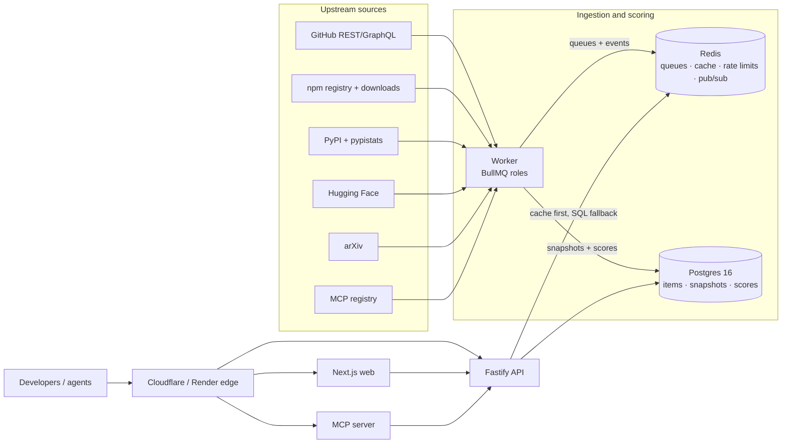

# Trendr

Developer-artifact trending tracker. Trendr watches what developers are paying attention to across
**GitHub, npm, PyPI, Hugging Face, arXiv and the MCP registry**, scores _velocity_ (not raw
popularity), and serves the result through a public API, an SSE live leaderboard, a Next.js UI and
an MCP server for agents.

> Built from [`TRENDR_SPEC.md`](./TRENDR_SPEC.md) (v1.1, frozen). Spec deviations and verified gaps
> are tracked in [`docs/SPEC_REVIEW.md`](./docs/SPEC_REVIEW.md); decisions live in
> [`docs/adr/`](./docs/adr).

## Status

| Phase | Scope                                            | State          |
| ----- | ------------------------------------------------ | -------------- |
| 0     | Scaffolding, tooling, CI skeleton, Compose stack | ✅ done        |
| 1     | Database + core domain                           | ✅ done        |
| 2     | Scoring engine (TDD)                             | ✅ done        |
| 3     | Read API (public)                                | ✅ done        |
| 4     | Ingestion framework + GitHub adapter             | ✅ done        |
| 5     | npm, PyPI, Hugging Face, arXiv, MCP adapters     | ✅ done        |
| 6     | Web frontend                                     | ✅ done        |
| 7     | Accounts, watchlists, alerts, digest             | ✅ done        |
| 8     | MCP server                                       | ✅ done        |
| 9     | Observability, security, operations              | ✅ done        |
| 10    | Deployment and polish                            | 🚧 in progress |

## Stack

- **API** — Fastify 5 + Zod (schema-first, RFC 7807 errors, OpenAPI from the same schemas)
- **Worker** — BullMQ on Redis 7 (schedulers, retries, rate-limited source adapters)
- **Data** — PostgreSQL 16 + Drizzle ORM (monthly-partitioned `snapshots`, raw-SQL migrations)
- **Web** — Next.js 15 App Router + Tailwind v4 and local shadcn-style primitives
- **MCP** — Model Context Protocol server (stdio + Streamable HTTP)
- **Tooling** — TypeScript 5 strict, pnpm 11 workspaces + Turborepo, Vitest, ESLint 9, Prettier,
  Docker Compose, GitHub Actions

## Repository layout

```text
apps/api        Fastify API              packages/config   zod env schema (fail-fast)
apps/worker     BullMQ worker            packages/core     domain types, errors, scoring
apps/web        Next.js frontend         packages/db       Drizzle schema, repos, migrations
apps/mcp        MCP server               packages/email    SMTP/Resend sender + React Email
                                         packages/logger   pino factory + redaction
                                         packages/sources  source adapters (Phase 4+)
infra/          Dockerfiles, prometheus + grafana provisioning
docs/           ADRs, spec review, UI mockups
```

## Quickstart

Prerequisites: **Node 22**, **pnpm 11** (`corepack enable`), **Docker** (Compose v2).

```bash
pnpm install
cp .env.example .env            # safe local defaults; add tokens when you have them

# Option A — dev processes (turbo)
pnpm dev                        # api :4000, web :3000, worker, mcp

# Option B — full stack in Docker (blocks until healthy)
docker compose up --build --wait postgres redis migrate api worker web mcp
```

| Service                    | Where                                                                    |
| -------------------------- | ------------------------------------------------------------------------ |
| API                        | http://localhost:4000 (`/healthz`, `/readyz`)                            |
| Web                        | http://localhost:3000                                                    |
| MCP (HTTP transport)       | http://localhost:4100                                                    |
| Mailpit (email UI)         | http://localhost:8025 (magic-link sign-in at `/login`)                   |
| Worker metrics             | `worker:9464` inside the network only; `/metrics` needs the bearer token |
| Prometheus (profile `obs`) | http://localhost:9090                                                    |
| Grafana (profile `obs`)    | http://localhost:3001                                                    |
| Jaeger (profile `obs`)     | http://localhost:16686                                                   |

Compose publishes Postgres, Redis, and MCP on `127.0.0.1` only. These are
local-development defaults; do not reuse this topology or its default
credentials in a shared or production environment (see the runbook).

Operational details — metrics, alert rules, manual maintenance jobs, retention
policy and incident checklists — live in the [runbook](./docs/runbook.md).

## Commands

| Command                                                 | What it does                                          |
| ------------------------------------------------------- | ----------------------------------------------------- |
| `pnpm dev` / `pnpm build`                               | Turbo: run / build every workspace                    |
| `pnpm lint` / `pnpm typecheck`                          | ESLint (type-checked) / `tsc --noEmit`                |
| `pnpm test` / `pnpm test:coverage` / `pnpm test:int`    | Vitest unit / unit + coverage / integration           |
| `CONTRACT=1 pnpm test:contract`                         | Live upstream schema probes (nightly CI)              |
| `pnpm db:generate` / `pnpm db:migrate` / `pnpm db:seed` | Drizzle migrations and seed data                      |
| `pnpm fixtures:record`                                  | Record upstream API fixtures for adapter tests        |
| `pnpm ingest:bootstrap` / `pnpm worker:score`           | Manual ingestion / scoring triggers                   |
| `pnpm obs:smoke`                                        | Validate the `obs` profile: rules, targets, dashboard |

## Environment

Key variables — the full annotated list is in [`.env.example`](./.env.example).

| Variable                        | Default                           | Purpose                                      |
| ------------------------------- | --------------------------------- | -------------------------------------------- |
| `NODE_ENV` / `LOG_LEVEL`        | `development` / `info`            | Runtime mode and pino level                  |
| `DATABASE_URL`                  | `…localhost:5432/trendr`          | Postgres connection (compose overrides host) |
| `REDIS_URL`                     | `redis://localhost:6379`          | Cache, queue and rate-limit store            |
| `API_PORT`                      | `4000`                            | Fastify listen port                          |
| `CORS_ORIGINS`                  | `http://localhost:3000`           | Allowed browser origins                      |
| `JWT_SECRET` / `API_KEY_PEPPER` | `change-me…`                      | Auth signing / key hashing (replace in prod) |
| `UNSUBSCRIBE_SECRET`            | `change-me…`                      | HMAC key for alert/digest unsubscribe links  |
| `METRICS_TOKEN`                 | `change-me-metrics-token`         | Bearer token for `/metrics`                  |
| `WORKER_ROLES`                  | `scheduler,ingest,scoring,notify` | Comma-separated worker roles                 |
| `WORKER_METRICS_PORT`           | `9464`                            | Worker health/metrics port (never published) |
| `SCHEDULER_ENABLED`             | `true`                            | Enables BullMQ job schedulers                |
| `GITHUB_TOKENS` / `HF_TOKEN`    | empty                             | Upstream credentials (worker only)           |
| `EMAIL_PROVIDER` / `SMTP_URL`   | `smtp` / `…localhost:1025`        | Email delivery (Mailpit locally)             |
| `MCP_TRANSPORT` / `MCP_PORT`    | `http` / `4100`                   | MCP server mode and port                     |
| `MCP_API_KEY`                   | empty                             | Read-only API key used by MCP tool calls     |
| `MCP_HTTP_AUTH_TOKENS`          | empty                             | Comma-separated bearer tokens for `/mcp`     |
| `API_INTERNAL_URL`              | `http://api:4000`                 | API base URL used by the MCP server          |
| `NEXT_PUBLIC_API_URL`           | `http://localhost:4000`           | Browser-facing API base (web image only)     |

## API examples

Set `API` to the local API or the deployed origin. Public reads need no credentials; writes and
account routes use a bearer access token or `X-API-Key`.

```bash
API=http://localhost:4000

# Top five across all sources over the last 7 days.
curl -fsS "$API/v1/trending?scope=all&window=7d&limit=5" |
  jq '{runId, computedAt, rows: [.data[] | {rank, source: .item.source, name: .item.displayName, score, delta, current}]}'

# Fetch one item and its 30-day series. Item ids are numeric strings from the API.
ID=$(curl -fsS "$API/v1/trending?scope=all&window=24h&limit=1" | jq -r '.data[0].item.id')
curl -fsS "$API/v1/items/$ID" |
  jq '{id, source, displayName, tier, latestMetrics, scores}'
curl -fsS "$API/v1/items/$ID/history?granularity=day" |
  jq '{metric, kind, points: (.points | length)}'

# Search names, descriptions and topics.
curl -fsS "$API/v1/search?q=vector%20database&limit=5" |
  jq '.items[] | {id, source, name, current, score7d}'

# Live leaderboard over Server-Sent Events.
curl -N -H 'Accept: text/event-stream' \
  "$API/v1/stream/leaderboard?scope=all&window=7d"
```

The stream sends `leaderboard.snapshot` on connect and `leaderboard.update` after each scoring
run, with a `Last-Event-ID` header for reconnect replay. Errors are RFC 7807 problem documents
(`application/problem+json`), and paginated endpoints return a `Link: …; rel="next"` header when
`page.nextCursor` is set. Interactive OpenAPI docs are at `/docs` and the machine-readable
document is `/openapi.json`.

## MCP server

`apps/mcp` exposes the five read-only tools from spec §11:

| Tool               | What it does                                                                               |
| ------------------ | ------------------------------------------------------------------------------------------ |
| `get_trending`     | Leaderboard rows for GitHub, npm, PyPI, Hugging Face, arXiv or MCP, or the combined board. |
| `search_items`     | Catalog search by name, description or topic, with source/kind filters.                    |
| `get_item_history` | Metric history and a growth summary for one item (by id, or source + externalId).          |
| `compare_items`    | 2–5 items side by side with aligned series.                                                |
| `whats_new_in_mcp` | New or fastest-rising MCP servers with repository/package links.                           |

The server supports **stdio** (Claude Desktop, Cursor) and **stateless Streamable HTTP**
(`http://localhost:4100/mcp`, health at `http://localhost:4100/healthz`). It never reads the
database directly: tools call the public API with `X-API-Key: $MCP_API_KEY` when configured.

Create a read-only API key in the web settings (or use the seeded local account), then set
`MCP_API_KEY` in `.env` for Compose. Without a key, calls use the anonymous public rate limit.
`MCP_HTTP_AUTH_TOKENS` is optional in development; when set, remote clients must send
`Authorization: Bearer <one-of-the-tokens>` to `/mcp`. Outside `NODE_ENV=development` the
server refuses to start without it.

### Inspector

With the Compose stack running:

```bash
npx @modelcontextprotocol/inspector --cli http://localhost:4100/mcp --method tools/list
npx @modelcontextprotocol/inspector --cli http://localhost:4100/mcp --method tools/call \
  --tool-name get_trending --tool-args-json '{"source":"npm","window":"7d","limit":3}'
```

If `MCP_HTTP_AUTH_TOKENS` is set, add
`--header "Authorization: Bearer <token>"` to both commands. The HTTP transport intentionally
returns 405 for GET/DELETE on `/mcp`; clients must POST Streamable HTTP messages.

### Claude Desktop (stdio)

Build the workspace, then point Claude at the compiled entry point. Use an absolute path; the
package is currently private, so `npx @trendr/mcp` is only available after publishing.

```json
{
  "mcpServers": {
    "trendr": {
      "command": "node",
      "args": ["C:/absolute/path/to/trendr/apps/mcp/dist/main.js"],
      "env": {
        "MCP_TRANSPORT": "stdio",
        "API_INTERNAL_URL": "http://localhost:4000",
        "MCP_API_KEY": "dt_live_..."
      }
    }
  }
}
```

Restart Claude Desktop, then ask “What's trending on npm this week?” and confirm that it calls
`get_trending`. Stdio logs are written to stderr so stdout stays protocol-clean.

### Cursor (HTTP)

Add this to `.cursor/mcp.json` (or the equivalent Cursor settings UI):

```json
{
  "mcpServers": {
    "trendr": {
      "url": "http://localhost:4100/mcp"
    }
  }
}
```

Add `"headers": { "Authorization": "Bearer <token>" }` when HTTP auth tokens are enabled. Ask
Cursor to list MCP tools and call `whats_new_in_mcp`; both should work against the Compose stack.

### Remote HTTP (deployed)

The deployed endpoint is the same stateless Streamable HTTP route: `https://<mcp-host>/mcp`
(the Render Blueprint uses `https://trendr-mcp.onrender.com/mcp`; the VPS serves
`https://<domain>/mcp`). Set `MCP_HTTP_AUTH_TOKENS` on the server and send one of those values as
`Authorization: Bearer <token>` from the client. `MCP_API_KEY` remains the server's read-only key
for calling the public API; it is not the client credential.

```json
{
  "mcpServers": {
    "trendr": {
      "url": "https://<mcp-host>/mcp",
      "headers": { "Authorization": "Bearer <one-of-MCP_HTTP_AUTH_TOKENS>" }
    }
  }
}
```

Health is `GET https://<mcp-host>/healthz`. See the [runbook](./docs/runbook.md) for the VPS and
Render deployment paths.

### Manual check log

- **2026-10-22:** Inspector CLI listed all five tools and `get_trending` returned three structured
  npm rows against the local Compose stack. Claude Desktop/Cursor configuration is documented
  above; the HTTP and stdio transports are covered by `apps/mcp/test/http.test.ts` and
  `apps/mcp/test/tools.test.ts`.

## Architecture



### In one paragraph

Postgres is the source of truth; Redis carries the cache, rate-limit buckets, BullMQ queues and
pub/sub. The worker ingests upstream APIs into partitioned `snapshots`, runs the scoring engine per
(source, window), publishes leaderboards to Redis ZSETs, evaluates alert rules, and sends digest
and alert email through `packages/email`; the API reads Redis first and falls back to SQL; SSE
broadcasts leaderboard updates to the web app. Magic-link sessions keep the access token in memory
and rotate an httpOnly refresh cookie. See `TRENDR_SPEC.md` §3 for the full component diagram and
§8 for the scoring model; [`docs/adr/0021-deployment-topology.md`](./docs/adr/0021-deployment-topology.md)
covers the VPS and Render deployment shapes.

## Design decisions

ADRs record choices that are expensive to reverse and the evidence behind them. The full set is in
[`docs/adr/`](./docs/adr).

| Area                   | Decisions                                                                                                                                                                                                                                                                                                                                                                                                        |
| ---------------------- | ---------------------------------------------------------------------------------------------------------------------------------------------------------------------------------------------------------------------------------------------------------------------------------------------------------------------------------------------------------------------------------------------------------------- |
| Stack                  | [0001 Fastify over Express](./docs/adr/0001-fastify-over-express.md), [0002 Drizzle over Prisma](./docs/adr/0002-drizzle-over-prisma.md), [0003 BullMQ over Kafka/RabbitMQ](./docs/adr/0003-bullmq-over-kafka.md)                                                                                                                                                                                                |
| Data                   | [0004 monthly-partitioned snapshots](./docs/adr/0004-partitioned-snapshots.md), [0010 sources vs dist resolution](./docs/adr/0010-sources-vs-dist-resolution.md), [0014 Hugging Face rolling downloads](./docs/adr/0014-hf-latest-only-downloads.md), [0015 MCP registry sync](./docs/adr/0015-mcp-registry-sync.md), [0016 additive topic persistence](./docs/adr/0016-additive-topic-persistence.md)           |
| Build and test         | [0005 one-shot migrate with Compose](./docs/adr/0005-gap10-compose-wait-one-shot-migrate.md), [0006 `pnpm deploy --legacy`](./docs/adr/0006-gap11-pnpm-deploy-legacy.md), [0007 dependency-direction lint](./docs/adr/0007-dependency-direction-lint.md), [0008 Vitest root workspace](./docs/adr/0008-vitest-root-workspace.md), [0009 container build hardening](./docs/adr/0009-container-build-hardening.md) |
| Upstream reality       | [0011 GitHub GraphQL batch cost](./docs/adr/0011-gap1-graphql-batch-cost.md), [0012 stargazer backfill cap](./docs/adr/0012-gap7-stargazer-backfill-cap.md), [0013 fine-grained PAT expiry](./docs/adr/0013-gap8-pat-expiry.md)                                                                                                                                                                                  |
| Serving and operations | [0017 shared email boundary](./docs/adr/0017-shared-email-boundary.md), [0018 MCP stateless HTTP](./docs/adr/0018-mcp-runtime-boundary.md), [0019 observability boundaries](./docs/adr/0019-observability-boundaries.md), [0020 security hardening](./docs/adr/0020-security-hardening.md), [0021 deployment topology](./docs/adr/0021-deployment-topology.md)                                                   |

## Interview talking points

The spec's §19.2 table is the long version. These are the trade-offs worth walking through with the
code open:

| Topic                                  | What to explain                                                                                                                                                                                        |
| -------------------------------------- | ------------------------------------------------------------------------------------------------------------------------------------------------------------------------------------------------------ |
| Velocity vs popularity                 | `log10(1+Δ) · (Δ/(B+k))^β`: log damping for the absolute term, sub-linear relative growth, and a smoothing prior that stops tiny-base explosions.                                                      |
| Counters vs daily aggregates           | GitHub stars are cumulative counters, so diff snapshots; npm/PyPI downloads are daily aggregates, so compare period sums. Late data uses a 3-day upsert window, and weekday seasonality is normalized. |
| Cross-source comparability             | Robust z-score on `ln(1+score)` (median/MAD) rather than mean/σ, plus a max-share cap on the combined board so one source cannot dominate.                                                             |
| BullMQ vs Kafka vs RabbitMQ            | BullMQ provides cron, delays, retries and rate limiting on the Redis that already exists. Kafka earns its place only for replay or high fan-out; RabbitMQ plus an outbox serves domain events.         |
| Rate limiting as a distributed problem | A Redis token bucket shared by every worker, upstream header feedback, ETag conditional requests that cost no primary quota on 304, and GraphQL batching.                                              |
| Idempotency everywhere                 | Deterministic job ids, natural-key upserts, bucketed `captured_at`, and dedupe keys for alerts/digests. A crash mid-batch duplicates nothing; a retry completes the work.                              |
| Time-series in Postgres                | Monthly range partitions give pruning and O(1) retention via `DROP PARTITION`, with BRIN indexes; TimescaleDB is optional, not required for a managed host.                                            |
| Pagination and cache                   | A cursor pinned to the scoring `run_id` keeps pages snapshot-consistent; Redis ZSET swap with `RENAME`, version ETags, and a Postgres fallback when the cache is down.                                 |
| Real time                              | SSE is one-way, HTTP-friendly, and reconnects with `Last-Event-ID`; Redis pub/sub fans out across API replicas and heartbeats survive proxy buffering.                                                 |
| Security and ops maturity              | Hashed API keys with a pepper, refresh-token reuse detection, SSRF allowlists, RFC 8058 unsubscribe, RED metrics, freshness SLOs, and a DLQ with admin replay.                                         |
| AI-native surface                      | The MCP server reuses the public API instead of opening a second data path, with structured outputs and read-only annotations.                                                                         |

## Deployment

Two topologies use the same images:

- **VPS (primary):** `docker-compose.prod.yml` with nginx, Cloudflare origin TLS, and no published
  Postgres/Redis/MCP ports. `infra/scripts/bootstrap-vps.sh` provisions the host.
- **Render (managed alternative):** `render.yaml` runs the prebuilt GHCR images with Render
  Postgres and Key Value. See ADR-0021 for the trade-offs and the free-tier limits.

`.github/workflows/publish.yml` builds `linux/amd64`/`linux/arm64` images on `v*` tags or manual
dispatch. The [runbook](./docs/runbook.md) covers first deploy, verification, rollback, backups and
both deployment paths.

## Testing and CI

Vitest runs as one workspace from the repo root with `unit`, `int` and `contract` projects;
workspace packages resolve to sources, so tests never need a prior build. The contract project is
gated by `CONTRACT=1`, makes real upstream requests, and runs only in the nightly CI job. CI
([`.github/workflows/ci.yml`](./.github/workflows/ci.yml)) runs lint + typecheck, unit tests with a
coverage artifact, integration tests, `gitleaks` + `pnpm audit`, and a Compose smoke test that
builds the whole stack, waits for health, seeds the database, triggers a scoring run and asserts
`/v1/trending` returns entries.

## Troubleshooting

- **Docker builds fail with registry timeouts** — image builds throttle installs
  (`--network-concurrency 6`, IPv4-first DNS) and pin pnpm via corepack. Build images one at a time
  (`docker compose build api && docker compose build worker && …`) to share the pnpm store cache
  mount. Details: ADR-0009.
- **`migrate` exits 0 and the stack still comes up** — expected: it is a one-shot service and
  `--wait` accepts `Exited (0)` on Compose v5.4+. Details: ADR-0005.
- **`docker compose port worker 9464` prints `invalid IP:0`** — Compose CLI quirk; 9464 is
  `expose`d for Prometheus only, never published. Verify with `docker inspect … NetworkSettings.Ports`.

## Documentation

- [`TRENDR_SPEC.md`](./TRENDR_SPEC.md) — the frozen specification (v1.1)
- [`CLAUDE.md`](./CLAUDE.md) — agent/contributor operating rules (spec Section 0)
- [`docs/adr/`](./docs/adr) — architecture decision records
- [`docs/SPEC_REVIEW.md`](./docs/SPEC_REVIEW.md) — deviations, verified gaps, deferred steps
- [`docs/REMEDIATION_PLAN.md`](./docs/REMEDIATION_PLAN.md) — CI remediation and Phase 10 plan
- [`docs/runbook.md`](./docs/runbook.md) — operations, deployment, backups and incident checklists
- [`render.yaml`](./render.yaml) / [`docker-compose.prod.yml`](./docker-compose.prod.yml) — deployment artifacts
- [`docs/mockups/`](./docs/mockups) — UI mockups (reference for Phase 6)
